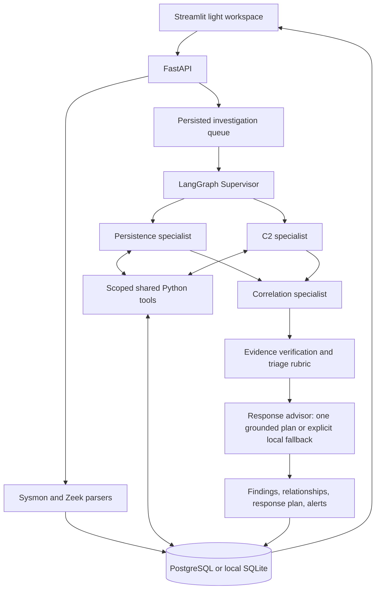

# Persistence–C2 investigation architecture

## Data flow

Runtime data is isolated by Compose project: product uses
`multi-agent-security-product` (8000/8501), verification uses
`multi-agent-security-verification` (18000/18501). Each has its own PostgreSQL volume.
No input logs are seeded during application startup. Input samples, collected logs and
legacy archives live outside the product in `verification/logs/`. Automated mutation
scripts require the verification environment marker from health. See
[manual product testing](MANUAL_PRODUCT_TEST.md).

The source-aware Supervisor selects Persistence, C2 and Correlation stages from the records available inside the requested scope. Each specialist can access every selected source through shared tools. The graph ends at verification and report generation. Provider specialists have bounded tool-calling loops. Correlation receives earlier findings, relationships and specialist assessments.

Agent implementations live in `product/app/agents/supervisor_agent.py`, `persistence_agent.py`, `c2_agent.py` and `correlation_agent.py`. `product/app/agents/specialists.py` provides their shared provider/tool-calling runtime. Shared graph state lives in `product/app/schemas/investigation_state.py`. `product/app/services/workflow.py` imports these agents, connects their nodes and applies verification/report stages. Shared queries, statistics, detectors, correlation helpers and ATT&CK lookup live in `product/app/tools/`. Severity and response playbooks live in `product/app/services/`.

The backend has six packages: `agents`, `ingestion`, `db`, `schemas`, `tools` and `services`. `product/app/main.py` is the FastAPI entrypoint, `product/app/config.py` holds settings, and `product/app/common.py` contains UTC/logging helpers. Offline evaluation and its synthetic scenarios are under `verification/scripts/`. Generated outputs and local demo databases are under `verification/artifacts/`.

Offline mode runs Python detectors and statistics. Gemini and DeepSeek use the OpenAI-compatible SDK to select tools and produce structured Vietnamese hypotheses with evidence references. Invalid references discard the provider assessment. The deterministic findings, correlations and severity remain available when a provider fails. Provider narrative semantics require analyst review.

## Schema and migration

`datasets` stores filenames, source, SHA-256, ingest time, record count and metadata. `events` preserves original structured fields, normalized fields, record position and UUID evidence identity. Zeek hostnames remain empty until an explicit time-bounded mapping is supplied. XML stores structured original fields; byte-for-byte XML preservation requires keeping the uploaded original outside the application.

Migration `0002_multisource` adds columns and indexes to the v0.4 schema and creates investigations, findings, alerts and audit entries. Existing evidence UUIDs and raw data are preserved. Legacy Sysmon fields are normalized during migration. Optional fields that fail new validation retain their raw representation with an empty normalized object. PostgreSQL startup migration is serialized by an advisory transaction lock.

Each upload creates an isolated dataset. A repeated source and file hash records `duplicate_of` in metadata. The application preserves both uploads deliberately.

## Scope and correlation

Queries enforce selected dataset IDs and timezone-aware time bounds. Host queries select that Sysmon host and Zeek IPs supplied through valid host–IP mappings. An explicit IP further limits network evidence. Selecting only datasets/time intentionally analyzes that selected scope across hosts.

Investigation evidence is capped per source, using the earliest records. Coverage includes matching count, returned count and truncation. Event browsing exposes pagination independently. Relationships are capped at 500 with a warning at the cap.

Supported cross-source association requires a host-matched ProcessGuid, Sysmon Event 3, a complete 5-tuple and a timestamp difference up to two seconds. Mapping and temporal proximity within five minutes produce a low-confidence hypothesis. NAT, clock skew, target execution and causality need analyst validation. Process lineage and network statistics are computed in Python.

## Severity and response

The versioned `triage-1.0` rubric assigns informational priority to generic registry changes, low to long-DNS-label anomalies and configured benign periodic traffic, medium to persistence/periodicity indicators, and high to supported cross-source associations involving a network hypothesis. Critical priority is available through documented analyst review. Asset criticality is recorded as analyst context. These levels describe investigation priority and require validation against labeled lab and real-world cases.

Severity and confidence are separate fields. Recommendations include verification, preservation, conditional containment, remediation and recovery, with conditions, operational impact and verification steps. Analysts update progress and severity with an audit note. The local playbook produces guidance for the human operator.

## Timing and alert semantics

`detected_at` is recorded after deterministic evidence verification and initial severity assessment. `alert_created_at` records server-side alert construction. `detection_to_alert_ms` is their difference, before database transaction commit and UI polling. The UI displays it as detection-to-alert-creation latency. Browser presentation/network delivery latency is outside this measurement. Runtime, tool timings, provider attempts and reported token usage are stored separately. Dataset creation time supplies the ingest timestamp. Historical log event time remains an independent field.

Alert thresholds use `ALERT_MIN_SEVERITY` and `ALERT_MIN_CONFIDENCE`. Alerts are unique per investigation. Retries of the same finalization cannot create duplicate alerts. Rerunning an investigation creates a distinct analysis and alert history.

## Jobs and operational boundaries

The database queue uses conditional updates to claim a job once. Each API process runs up to its configured worker-thread limit. A worker renews leases while its execution thread runs. Expired leases become interrupted failures. Users can cancel queued or running work. Checkpoints prevent a cancelled worker from publishing results. SQLite writer transactions and PostgreSQL row locks serialize finalization and analyst edits. Provider requests have explicit timeouts and SDK retries are disabled. Record, tool, provider-call, output-token and observed-token budgets bound analysis. The observed-token stop applies before the next provider call.

The application is a local, loopback-bound research workspace with a shared analyst identity. Authentication, tenant isolation and remote production hosting require a separate design. API keys stay on the backend. API/worker logs exclude raw records and credentials. Uploads are size-limited, XML DTD/entities are rejected, and model inputs contain bounded projections of untrusted records.

## Knowledge sources

The local retrieval corpus is curated and versioned, covering five techniques. Providers can call `attack_lookup` during investigation. Corpus updates require review of the linked official sources and version metadata.

- [Registry Run Keys / Startup Folder](https://attack.mitre.org/techniques/T1547/001/)
- [Scheduled Task](https://attack.mitre.org/techniques/T1053/005/)
- [Windows Service](https://attack.mitre.org/techniques/T1543/003/)
- [Web Protocols](https://attack.mitre.org/techniques/T1071/001/)
- [DNS](https://attack.mitre.org/techniques/T1071/004/)
- [Zeek connection logs](https://docs.zeek.org/en/current/reference/logs/conn.html)
- [Zeek log formats](https://docs.zeek.org/en/current/tutorial/logs.html)
